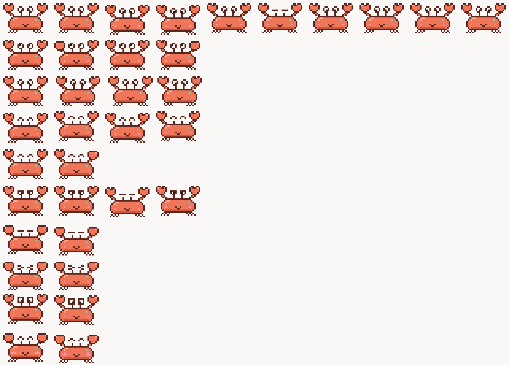

# 小螃蟹 CrabKit

一只住在 iOS 界面里的像素小螃蟹，用 SwiftUI 写的。它会自己沿着一条线溜达、东张西望、挥钳子，
很久没人理会打哈欠睡着；你可以戳它、把它戳害羞、长按拎起来拖走、往下一划把它拍扁。
干活的时候它会横着写字、写完开心蹦一下，还能跑进灵动岛和桌面小组件。

这个仓库只有小螃蟹的前端部分（像素帧、动画、交互、灵动岛和小组件的界面），
不包含任何服务器、接口或账号相关的代码。需要「后端」的地方用 `MockReplyEngine` 假装。

开源的这一只是爱心钳子小螃蟹：



## 它会干什么

- 闲着时自己溜达，停下来眨眼、东张西望、挥钳子、原地蹦
- 点一下：缩一下再开心；两秒内连戳三下会害羞
- 长按 0.35 秒拎起来，跟着手指走，松手落地弹一下
- 很久没理它会打哈欠，然后睡着冒 zzz；这时戳它会吓一跳
- 看时间：半夜揉眼睛犯困、困得更快；早上伸懒腰
- 打字时扒着输入框往里瞄，删字就捂眼睛
- 往下一划拍扁：扁成一张饼、掉眼泪，三秒后鼓回来
- 收到暗号（`CrabCue`）：冒小爱心、抱着小花跑一圈、学你贴的表情（❤️ 😂 👍 😭 😳 🥺）、举牌念一句话
- 干活状态：`thinking` 想事吐泡泡，`walking` 横着写字，`happy` 写完蹦一下
- 灵动岛 / 锁屏实时活动，和桌面小组件（小号、中号）

## 需要什么

- Xcode 16 或更新（在 Xcode 27.2 上编译通过）
- iOS 17 或更新
- 没有任何第三方依赖

## 怎么跑起来

### 最快：看预览

1. 用 Xcode 打开本目录里的 `Package.swift`。
2. 打开 `Sources/CrabKit/CrabPlayground.swift`，右边画布就是演示页（Editor → Canvas）。

### 跑一个演示 app

1. Xcode → File → New → Project → iOS App（界面选 SwiftUI），随便起个名字。
2. File → Add Package Dependencies… → Add Local…，选本目录；把 `CrabKit` 加到 app target。
3. 把自动生成的 `XXXApp.swift` 换成 `Examples/CrabDemo/CrabDemoApp.swift` 的内容。
4. 选模拟器或你的手机，⌘R。真机要在 Signing & Capabilities 里选你自己的 Team。

### 在自己的 app 里用

```swift
import CrabKit

struct ChatScreen: View {
    @State private var draft = ""
    @State private var working: CrabState = .idle
    @State private var cue: CrabCue?

    var body: some View {
        VStack(spacing: 0) {
            // …你的消息列表…
            RoamingCrab(working: working, roams: true, pixel: 2, typing: draft.count, cue: cue)
            TextField("说点什么", text: $draft)
        }
    }
}
```

- 开始生成回复时把 `working` 设成 `.thinking`，开始出字设成 `.walking`，写完设 `.happy` 再回 `.idle`。
- 递暗号：`cue = CrabCue(kind: .heart, serial: n)`，`serial` 每次加一。
- 想让它能被拎到整个聊天区：把那块区域的全屏坐标写进 `CrabStage.shared.area`。
- 只要一只不会动的螃蟹：`CrabView(state: .wave, pixel: 4)`；干活小条：`WorkingCrab(state: .thinking, bubbles: true)`。
- 想知道用户对它做了什么：`CrabLog.shared.takeNote()` 会返回一句旁白（比如「戳了它 3 下」），拿完清空；`CrabLog.shared.onNote` 可以逐次回调。
- 颜色在 `CrabTheme` 里，都可以改。甜甜的词在 `CrabCue.sweetWords` 里，也可以改。

### 灵动岛和桌面小组件（可选）

1. 给 app 加一个 Widget Extension target，依赖 `CrabKitWidgets`，入口用 `Examples/CrabDemo/CrabDemoWidgets.swift`。
2. app 的 Info.plist 加 `NSSupportsLiveActivities = YES`。
3. app 和扩展打开同一个 App Group，并在两边启动时设置 `CrabSnapshot.appGroup = "group.你的.id"`。
4. app 里：`IslandCrab.shared.start(title:style:)` → `set(.writing)` → `finish()`；
   更新桌面小组件：`CrabSnapshot(pose: "happy", voice: "写好啦").publish()`。

系统规定：自己的 app 在前台时灵动岛不显示，切到别的 app 或回桌面才看得见。

## 聊天页（CrabChat）

`CrabChat` 是单独的一个库，依赖 `CrabKit`。里面是聊天页、输入框，以及发送时那颗气泡飞到消息列表的动画。
回复在本地按固定节奏写出来，对话只留在内存里，也不写入小组件的共享存储。没有账号、没有网络、没有数据库。

演示界面是 `ChatPlayground()`，或者 `CrabDemo` 里的 `CrabDemoScreen()`（聊天和螃蟹各一页）。

## 文件在哪

- `Sources/CrabKit/Sprites/`：爱心钳子小螃蟹的像素帧（每个字符一个像素，`.` 透明，字母查 `CrabPalette`）
- `Sources/CrabKit/CrabView.swift`：状态、画一只会动的螃蟹、干活小条
- `Sources/CrabKit/RoamingCrab.swift`：会溜达、能戳能拎能拍扁的那只
- `Sources/CrabKit/CrabCue.swift`：暗号、时段问候
- `Sources/CrabKit/CrabLog.swift`：互动记录
- `Sources/CrabKit/IslandCrab.swift`、`CrabActivity.swift`：灵动岛
- `Sources/CrabKit/CrabSnapshot.swift`：给桌面小组件的数据
- `Sources/CrabKit/MockReplyEngine.swift`、`CrabPlayground.swift`：不联网的演示
- `Sources/CrabKitWidgets/`：灵动岛、锁屏、桌面小组件的界面
- `Sources/CrabChat/`：聊天页、输入框、发送气泡的飞行、内存里的假回复
- `Examples/CrabDemo/`：演示 app 和小组件扩展的入口
- `docs/images/`：姿势表

## 许可

MIT，见 [LICENSE](LICENSE)。来源说明见 [CREDITS.md](CREDITS.md)。
